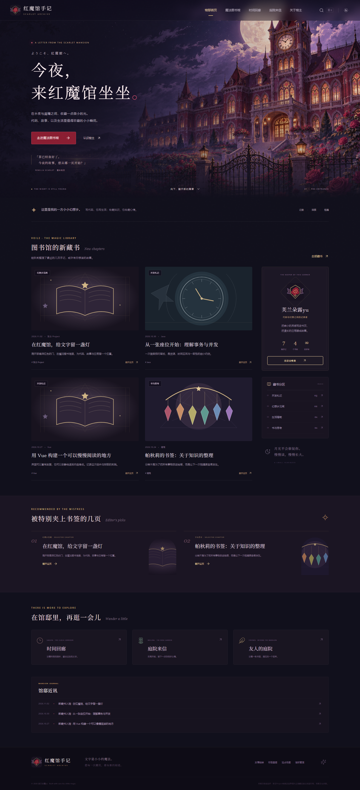

# Scarlet Archive · 红魔馆手记

[](https://github.com/FLandreyu/ScarletArchive/actions/workflows/ci.yml)

一座可以阅读、探索与来信的虚拟红魔馆。Vue 3 + TypeScript + Java 21 / Spring Boot 3 的个人博客，包含真实管理后台、文章草稿和发布、图书馆检索、庭院审核与星晶房间。

源码仓库：[FLandreyu/ScarletArchive](https://github.com/FLandreyu/ScarletArchive)。当前仓库提供源码、测试和部署配置；线上访问地址将在实际部署完成后补充。



## 启动

Windows 双击 **`启动红魔馆.cmd`**，打开 **http://127.0.0.1:8098**。

- 管理后台：**http://127.0.0.1:8098/admin**
- 本地初始账号：`admin` / `Scarlet123!`
- 环境：JDK **21-25**、Maven 3.6.3+、Node.js 22.12+；首次安装依赖需要联网。
- 已构建后快速启动：`powershell -ExecutionPolicy Bypass -File scripts/Start-Scarlet.ps1 -SkipBuild`
- 停止：运行窗口 Ctrl+C。修改端口可设置 `SERVER_PORT`。

本地默认使用 **H2文件数据库**，数据和随机签名密钥保存在 `backend/data/`，上传文件在 `backend/data/uploads/`。从 `backend` 运行Java以保持数据路径一致。不会修改同级的 SeatFlow 或简历文件。

首次创建7篇公开示例文章、1篇草稿、4个分类、5个标签、示例留言和友链。示例文章与活动不是线上用户数据。已有数据不会在重启时重建。`ADMIN_PASSWORD` 仅用于首次创建管理员；改变环境变量不会覆盖数据库中的旧密码。

## 已实现

| 区域 | 能力 |
| --- | --- |
| 蕾米莉亚的迎宾大厅 | 原创月下馆邸主景、欢迎语、真实最新/推荐文章、站长简介、分类入口和文章动态 |
| 帕秋莉的魔法图书馆 | 文章分页、全文关键词检索、分类/标签组合筛选、正逆时间排序、摘要和封面 |
| 阅读页 | 安全Markdown、按需代码高亮、复制、TOC、阅读进度、图片放大、标签、上下篇和相关文章 |
| 咲夜的时间回廊 | 年月归档、公开文章数量、非阻塞短钟表转场 |
| 访客档案 | 后台维护介绍、兴趣、时间线、项目经历、GitHub和邮箱 |
| 美铃的庭院 | 留言表单校验、频率限制、蜜罐、审核后公开、管理员撤回/删除 |
| 友人的庭院 | 展示、申请、审核、创建、编辑和删除友链 |
| 芙兰的星晶房间 | 独立主题、7枚可点亮水晶、完成记录、404与回家入口 |
| 管理书房 | 管理员登录/退出、文章CRUD、草稿、实时预览、封面上传、分类标签CRUD、审核、站点设置和首页推荐 |
| 工程 | Router路由懒加载、Pinia、Tailwind Token、GSAP、响应式、动画开关、减少动态偏好、Sitemap、robots和基础OG元信息 |

## 技术与关键取舍

**前端**：Vue 3、TypeScript、Vue Router、Pinia、Vite、Tailwind CSS 4、GSAP、Lucide、markdown-it、DOMPurify、Highlight.js。

**后端**：Java21编译目标、Spring Boot3.5.16、Spring Security、MyBatis、Bean Validation、MySQL8、HS256 JWT。Controller / Service / Mapper分层，手写SQL预编译绑定，统一JSON响应与分页，数据库约束兜底。Java源码和前端代码可用统一Prettier脚本格式化。

**运行/部署**：便捷本地模式由Spring同源提供构建后的网页；正式部署是Nginx前端 + 独立Java API + MySQL。H2是无需配置数据库的本地替代，不是把MySQL能力移除。未引入Redis、微服务、消息队列或LLM。

- 编辑保存使用数据库版本号条件更新，避免两个编辑窗口互相覆盖；文章与标签关系同事务提交。
- 草稿不会从公开详情、搜索、归档、分类计数或Sitemap泄露。
- 登录限流，密码BCrypt；JWT有效2小时并携带管理员版本号，退出后版本增加，旧令牌服务端校验失败。
- Markdown禁用原始HTML，DOMPurify再次净化；图片/友链协议校验，Vue文本转义显示用户输入。
- 上传只接受5MB内PNG/JPEG，校验解码器与像素上限，重编码到JPEG、随机命名，拒绝SVG和伪装文件。

## 本次验证

2026-11-03：**H2 42项、真实MySQL8.0.45 42项集成测试全部通过，8条桌面/手机Chromium流程通过**。后端用例包括草稿隔离、并发编辑冲突、JWT实际验签和撤销、审核、SQL注入输入、限流、伪造上传及真实图片重编码。浏览器实际创建草稿、发布并读取文章，检查安全预览、留言与友链审核、设置持久化、上传资源和手机无横向溢出。

详见 [验收记录](docs/验收记录.md)、[测试证据](docs/evidence/)、[浏览器截图](docs/screenshots/)。测试验证的是本地功能及边界，不代表生产吞吐、安全审计认证或真实用户规模。

## 开发和测试

```powershell
# 后端终端
cd backend
mvn spring-boot:run

# 前端终端，http://127.0.0.1:5180
cd frontend
npm ci
npm run dev

# 后端集成测试，独立内存库，不会操作日常演示文件库
cd backend
mvn test

# 类型检查与生产构建，输出到后端static资源目录
cd frontend
npm run build
npm run format:check

# 浏览器测试会创建文章、来信和友链并修改设置，请使用独立验收实例
npx playwright install chromium
$env:SCARLET_BASE_URL='http://127.0.0.1:8099'
npm run test:e2e
```

启用内存验收实例：从 `backend` 运行JAR，传 `--server.port=8099` 和 `--spring.datasource.url=jdbc:h2:mem:browser;MODE=MySQL;DATABASE_TO_LOWER=TRUE`。Windows中请将含分号的整项参数加单引号。不要同时重新打包正在运行的JAR，Windows会锁住文件。

## MySQL

先建立专用数据库与权限受限的业务账号：

```sql
CREATE DATABASE scarlet_archive CHARACTER SET utf8mb4 COLLATE utf8mb4_0900_ai_ci;
CREATE USER 'scarlet'@'localhost' IDENTIFIED BY '替换为自己的密码';
GRANT ALL PRIVILEGES ON scarlet_archive.* TO 'scarlet'@'localhost';
```

```powershell
$env:SPRING_PROFILES_ACTIVE='mysql'
$env:DB_USERNAME='scarlet'
$env:DB_PASSWORD='自己的密码'
$env:ADMIN_PASSWORD='首次创建账号使用的强密码'
# 可选 DB_URL，默认连接127.0.0.1:3306/scarlet_archive
powershell -ExecutionPolicy Bypass -File scripts/Start-Scarlet.ps1 -SkipBuild
```

MySQL集成测试使用**独立测试库**：设置 `TEST_DB_URL`、`TEST_DB_USERNAME`、`TEST_DB_PASSWORD` 后进入 `backend` 执行 `mvn test`。测试会初始化并写入这个库，不应指向正式或日常使用的数据库。

## Docker / Nginx

复制 `.env.example` 为 `.env`，填写数据库密码、管理员强密码和随机JWT密钥，设置真实 `PUBLIC_URL`。生成密钥：

```powershell
node -e "console.log(require('crypto').randomBytes(32).toString('base64'))"
docker compose up --build -d
```

容器会分别构建Vue前端和Java后端。Nginx处理SPA回退、静态资源缓存、gzip和API反向代理，数据库与Java端口不直接发布；网页默认映射本机8098。对公网部署需要配置域名和HTTPS、备份与访问策略。部署文件已提供，**当前机器没有Docker/Nginx可执行程序，本次未实际运行容器**。

## 文档与边界

- [设计与实施](docs/设计与实施.md)：架构、页面、数据模型、视觉Token和角色功能映射。
- [API说明](docs/API.md)：认证、请求体、权限、分页与错误码。
- [素材说明](docs/素材说明.md)：生成主景完整提示词、文件路径、自绘SVG与官方指南链接。
- [简历描述](docs/简历描述.md)：可复现、可讲解的项目经历。

尚未实现：访客账号、文章评论、文章历史版本/自动保存、AI助手、邮件订阅、密码找回与密码修改界面、分布式限流、上传孤立文件回收和SSR。公开文章搜索为数据库LIKE检索，不是搜索引擎；配置和标签更新不是全文索引系统。Sitemap/归档当前有10000篇上限。数据库脚本负责幂等首次建表，后续结构升级需要版本迁移方案。前台为SPA，直接访问未知单段路由会展示主题404，HTTP状态可能为200；完整SSR与严格SEO状态码是后续增强项。

这是非官方东方Project粉丝创作项目，与上海爱丽丝幻乐团或官方无关联。不使用第三方未授权角色插画、音乐、官方游戏素材。角色名称与世界观不属于本项目原创，素材生成也不意味着取得相关角色IP的所有权。
